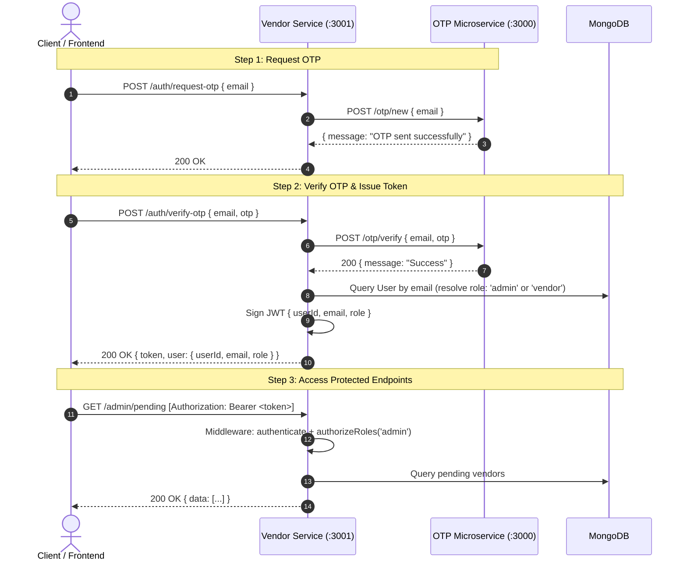

# Vendor Service - Role-Based Authentication with OTP Microservice

This microservice handles vendor registration, vendor data management, and administrator approval workflows. It integrates with the standalone **OTP Authentication Microservice** to authenticate users via one-time passwords without altering the OTP service.

---

## Architecture & Auth Flow



---

## Role-Based Access Control (RBAC) Matrix

| Endpoint | Method | Allowed Roles | Description |
| :--- | :--- | :--- | :--- |
| `/auth/request-otp` | `POST` | Public | Initiates OTP delivery to user's email via OTP microservice |
| `/auth/verify-otp` | `POST` | Public | Validates an existing vendor/admin OTP flow and returns a role-based JWT |
| `/auth/customer/request-otp` | `POST` | Public | Requests an OTP for customer registration/login |
| `/auth/customer/verify-otp` | `POST` | Public | Creates or authenticates a customer account and returns a customer JWT |
| `/auth/resend-otp` | `POST` | Public | Resends OTP adhering to cooldown rules in OTP microservice |
| `/auth/login` | `POST` | Public | Authenticates using email and hashed password, returns role-based JWT |
| `/auth/set-password` | `POST` | `vendor`, `admin` | Sets or updates account password after bcrypt hashing |
| `/auth/me` | `GET` | `vendor`, `admin` | Returns the authenticated user's profile and vendor data |
| `/register` | `POST` | `vendor`, `admin` | Registers vendor store with optional hashed password |
| `/vendor-data/profile` | `GET`, `PUT` | `vendor`, `admin` | Retrieves or updates the authenticated vendor's profile |
| `/vendor-data/upload-kyc` | `POST` | `vendor`, `admin` | Uploads KYC document files via Multer (PDF, PNG, JPG, WebP) |
| `/vendor-data/:userId` | `GET`, `PUT` | `admin`, or owning `vendor` | Vendor can only access/edit their own data; Admin can access any |
| `/admin/pending` | `GET` | `admin` | Lists all pending vendor approval requests |
| `/admin/approve` | `POST` | `admin` | Approves a vendor application |
| `/admin/reject` | `POST` | `admin` | Rejects a vendor application |
| `/products` | `POST` | Approved `vendor` | Creates a product for the authenticated vendor |
| `/products/my` | `GET` | `vendor` | Lists products belonging to the authenticated vendor |
| `/products/:productId` | `PATCH` | `vendor` | Updates an owned product |
| `/products/:productId` | `DELETE` | `vendor` | Deletes an owned product |
| `/customers/me` | `GET` | `customer` | Returns the authenticated customer profile |
| `/catalog/products` | `GET` | Public | Lists products from approved vendors |
| `/catalog/products/:productId` | `GET` | Public | Returns one product from an approved vendor |
| `/cart` | `GET`, `DELETE` | `customer` | Fetches or clears the authenticated customer's cart |
| `/cart/items` | `POST` | `customer` | Adds to a customer's cart, increasing existing quantity |
| `/cart/items/:productId` | `PATCH`, `DELETE` | `customer` | Updates or removes one cart item |

---

## Environment Variables (`services/vendor-service/.env`)

```env
PORT=3001
MONGO_URI=mongodb://localhost:27017/vendor-service
OTP_SERVICE_URL=http://localhost:3000
JWT_SECRET=replace-with-a-random-secret-at-least-32-characters
JWT_EXPIRES_IN=7d
ADMIN_EMAILS=admin@market.com,admin@example.com
```

- **`OTP_SERVICE_URL`**: Base URL of the running OTP microservice (default: `http://localhost:3000`).
- **`ADMIN_EMAILS`**: Comma-separated list of emails that are automatically granted the `admin` role upon OTP verification. All other emails default to `vendor`.
- **`JWT_SECRET`**: Required secret of at least 32 characters. The service refuses to start when it is missing or too weak.
- **`PORT`**: Set to `3001` so it does not collide with the OTP microservice on port `3000`.

---

## Example Requests

### 1. Request an OTP
```http
POST /auth/request-otp HTTP/1.1
Host: localhost:3001
Content-Type: application/json

{
  "email": "vendor@example.com"
}
```

### 2. Verify OTP & Obtain Role-Based JWT
```http
POST /auth/verify-otp HTTP/1.1
Host: localhost:3001
Content-Type: application/json

{
  "email": "vendor@example.com",
  "otp": "123456"
}
```
**Response:**
```json
{
  "message": "Authentication successful",
  "token": "eyJhbGciOi...",
  "user": {
    "userId": 1001,
    "email": "vendor@example.com",
    "role": "vendor"
  },
  "vendor": null
}
```

### 3. Register as a Vendor with Optional Password
```http
POST /register HTTP/1.1
Host: localhost:3001
Authorization: Bearer <token>
Content-Type: application/json

{
  "storeName": "My Awesome Store",
  "kycDocs": ["doc1.pdf"],
  "password": "MySecretPassword123!"
}
```
*The password is securely hashed via bcrypt before saving to MongoDB, and is omitted from all JSON responses.*

### 4. Authenticate Using Email & Password
```http
POST /auth/login HTTP/1.1
Host: localhost:3001
Content-Type: application/json

{
  "email": "vendor@example.com",
  "password": "MySecretPassword123!"
}
```

### 5. Set or Update Password
```http
POST /auth/set-password HTTP/1.1
Host: localhost:3001
Authorization: Bearer <token>
Content-Type: application/json

{
  "password": "NewSecretPassword456!"
}
```

### 6. Admin Access (Admin Role Only)
```http
GET /admin/pending HTTP/1.1
Host: localhost:3001
Authorization: Bearer <admin-token>
```
### 7. Create a Product (Approved Vendor Only)
```http
POST /products
Host: localhost:3001
Authorization: Bearer <vendor-jwt>
Content-Type: application/json

{
  "title": "Wireless Headphones",
  "description": "Noise-cancelling over-ear headphones",
  "price": 79.99,
  "stockQuantity": 25
}
```

For creation, the vendor ID is taken from the authenticated JWT and matched
against the vendor record. Client-provided vendor IDs and protected fields are
not used.

### 8. Update an Owned Product
```http
PATCH /products/653abc1234567890abcdef12
Host: localhost:3001
Authorization: Bearer <vendor-jwt>
Content-Type: application/json

{
  "price": 69.99,
  "stockQuantity": 20
}
```

Only `title`, `description`, `price`, and `stockQuantity` can be updated.
The product ID and authenticated vendor ID are enforced by the database query.

### 9. Delete an Owned Product
```http
DELETE /products/653abc1234567890abcdef12
Host: localhost:3001
Authorization: Bearer <vendor-jwt>
```

The product ID and authenticated vendor ID are enforced by the deletion query.

### 10. Customer Registration and Login

Customer authentication uses the existing OTP microservice and the same JWT
secret and payload convention as vendor/admin authentication. It has a
dedicated path so the existing `/auth/verify-otp` flow continues to create
vendor accounts for non-admin emails.

```http
POST /auth/customer/request-otp
Content-Type: application/json

{ "email": "buyer@example.com" }
```

```http
POST /auth/customer/verify-otp
Content-Type: application/json

{
  "email": "buyer@example.com",
  "otp": "123456",
  "displayName": "A Buyer"
}
```

The response contains a JWT with `role: "customer"` and a persisted customer
profile. If the email already belongs to a vendor or administrator, the
customer endpoint returns `409` instead of changing that account's role.
Customer profiles contain only `userId`, `email`, and optional `displayName`
plus timestamps. The profile is stored separately from the vendor document.

### 11. Public Catalog

The catalog is read-only and returns only products whose vendor currently has
`status: "approved"`. Vendor email, KYC documents, payout identifiers, and
other private vendor fields are never returned.

```http
GET /catalog/products?page=1&pageSize=20&search=headphones
```

```json
{
  "message": "Catalog products fetched successfully",
  "data": {
    "items": [
      {
        "productId": "653abc1234567890abcdef12",
        "title": "Wireless Headphones",
        "description": "Noise-cancelling headphones",
        "price": 79.99,
        "stockQuantity": 25,
        "createdAt": "2026-01-01T00:00:00.000Z",
        "updatedAt": "2026-01-01T00:00:00.000Z",
        "vendorId": 1001,
        "storeName": "Approved Store"
      }
    ],
    "page": 1,
    "pageSize": 20,
    "totalItems": 1,
    "totalPages": 1
  }
}
```

`pageSize` is limited to 50. Product detail requests use the same public
shape and return `404` when the product is missing or its vendor is not
approved.

### 12. Persistent Customer Cart

The cart is stored in MongoDB using one `Cart` document per customer
`userId`. Each item stores only a `productId` reference and a positive
`quantity`. Prices, stock, and store names are resolved from the current
`Product` and approved `Vendor` documents; clients cannot provide those
values.

Adding an existing item increases its quantity. The resulting quantity must
not exceed current stock. Cart reads revalidate product availability and
prices. If a product was deleted or its vendor is no longer approved, the
item remains in the cart with `available: false`, `currentPrice: null`,
`currentStock: 0`, and contributes zero to `total` until removed or the
product becomes available again.

#### Get the cart

```http
GET /cart
Authorization: Bearer CUSTOMER_JWT
```

#### Add an item

```http
POST /cart/items
Authorization: Bearer CUSTOMER_JWT
Content-Type: application/json

{
  "productId": "653abc1234567890abcdef12",
  "quantity": 2
}
```

#### Update an item

```http
PATCH /cart/items/653abc1234567890abcdef12
Authorization: Bearer CUSTOMER_JWT
Content-Type: application/json

{ "quantity": 3 }
```

#### Remove an item

```http
DELETE /cart/items/653abc1234567890abcdef12
Authorization: Bearer CUSTOMER_JWT
```

#### Clear the cart

```http
DELETE /cart
Authorization: Bearer CUSTOMER_JWT
```

Cart mutation responses use the following shape:

```json
{
  "message": "Cart item added successfully",
  "data": {
    "cartId": "cart-mongo-id",
    "items": [
      {
        "productId": "653abc1234567890abcdef12",
        "title": "Wireless Headphones",
        "description": "Noise-cancelling headphones",
        "currentPrice": 79.99,
        "quantity": 2,
        "currentStock": 25,
        "storeName": "Approved Store",
        "available": true,
        "itemTotal": 159.98
      }
    ],
    "total": 159.98,
    "currency": "USD",
    "updatedAt": "2026-01-01T00:00:00.000Z"
  }
}
```

An empty cart returns `items: []` and `total: 0`. Cart endpoints return
`401` for missing/invalid authentication, `403` for non-customer roles,
`400` for malformed IDs or quantities, `404` for missing/unavailable
products or absent cart items, and `409` when requested quantity exceeds
current stock.
