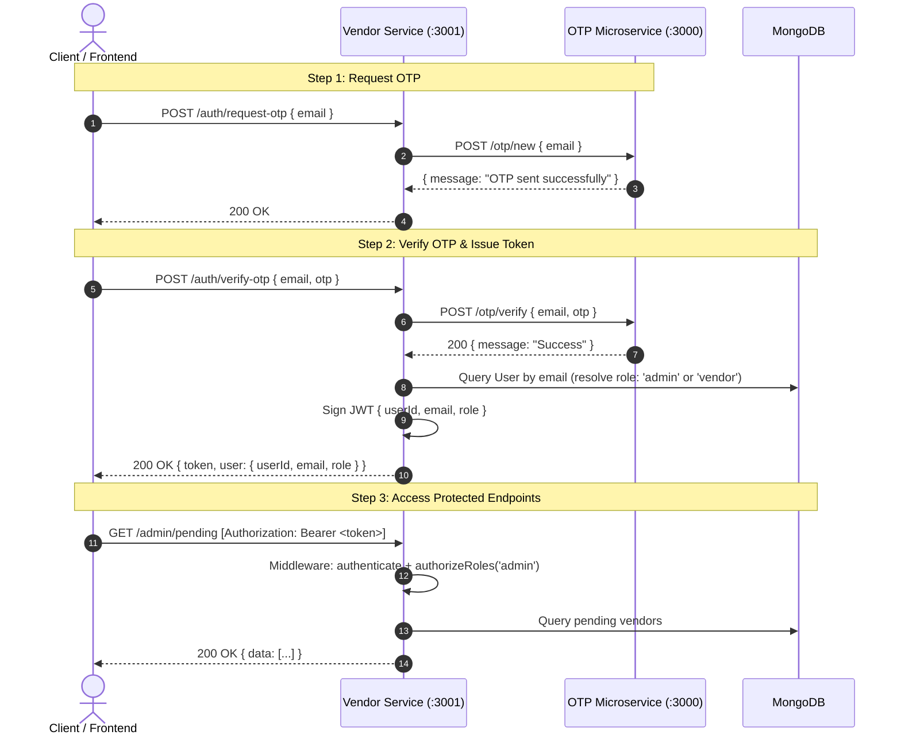

# Vendor Service - Role-Based Authentication with OTP Microservice

This microservice handles vendor registration, vendor data management, and administrator approval workflows. It integrates with the standalone **OTP Authentication Microservice** to authenticate users via one-time passwords without altering the OTP service.

---

## Architecture & Auth Flow



---

## Role-Based Access Control (RBAC) Matrix

| Endpoint | Method | Allowed Roles | Description |
| :--- | :--- | :--- | :--- |
| `/auth/request-otp` | `POST` | Public | Initiates OTP delivery to user's email via OTP microservice |
| `/auth/verify-otp` | `POST` | Public | Validates OTP with OTP service and returns a role-based JWT |
| `/auth/resend-otp` | `POST` | Public | Resends OTP adhering to cooldown rules in OTP microservice |
| `/auth/login` | `POST` | Public | Authenticates using email and hashed password, returns role-based JWT |
| `/auth/set-password` | `POST` | `vendor`, `admin` | Sets or updates account password after bcrypt hashing |
| `/auth/me` | `GET` | `vendor`, `admin` | Returns the authenticated user's profile and vendor data |
| `/register` | `POST` | `vendor`, `admin` | Registers vendor store with optional hashed password |
| `/vendor-data/profile` | `GET`, `PUT` | `vendor`, `admin` | Retrieves or updates the authenticated vendor's profile |
| `/vendor-data/upload-kyc` | `POST` | `vendor`, `admin` | Uploads KYC document files via Multer (PDF, PNG, JPG, WebP) |
| `/vendor-data/:userId` | `GET`, `PUT` | `admin`, or owning `vendor` | Vendor can only access/edit their own data; Admin can access any |
| `/admin/pending` | `GET` | `admin` | Lists all pending vendor approval requests |
| `/admin/approve` | `POST` | `admin` | Approves a vendor application |
| `/admin/reject` | `POST` | `admin` | Rejects a vendor application |

---

## Environment Variables (`vendor-service/.env`)

```env
PORT=3001
MONGO_URI=mongodb://localhost:27017/vendor-service
OTP_SERVICE_URL=http://localhost:3000
JWT_SECRET=super_secret_vendor_service_jwt_key_2026
JWT_EXPIRES_IN=7d
ADMIN_EMAILS=admin@market.com,admin@example.com
```

- **`OTP_SERVICE_URL`**: Base URL of the running OTP microservice (default: `http://localhost:3000`).
- **`ADMIN_EMAILS`**: Comma-separated list of emails that are automatically granted the `admin` role upon OTP verification. All other emails default to `vendor`.
- **`PORT`**: Set to `3001` so it does not collide with the OTP microservice on port `3000`.

---

## Example Requests

### 1. Request an OTP
```http
POST /auth/request-otp HTTP/1.1
Host: localhost:3001
Content-Type: application/json

{
  "email": "vendor@example.com"
}
```

### 2. Verify OTP & Obtain Role-Based JWT
```http
POST /auth/verify-otp HTTP/1.1
Host: localhost:3001
Content-Type: application/json

{
  "email": "vendor@example.com",
  "otp": "123456"
}
```
**Response:**
```json
{
  "message": "Authentication successful",
  "token": "eyJhbGciOi...",
  "user": {
    "userId": 1001,
    "email": "vendor@example.com",
    "role": "vendor"
  },
  "vendor": null
}
```

### 3. Register as a Vendor with Optional Password
```http
POST /register HTTP/1.1
Host: localhost:3001
Authorization: Bearer <token>
Content-Type: application/json

{
  "storeName": "My Awesome Store",
  "kycDocs": ["doc1.pdf"],
  "password": "MySecretPassword123!"
}
```
*The password is securely hashed via bcrypt before saving to MongoDB, and is omitted from all JSON responses.*

### 4. Authenticate Using Email & Password
```http
POST /auth/login HTTP/1.1
Host: localhost:3001
Content-Type: application/json

{
  "email": "vendor@example.com",
  "password": "MySecretPassword123!"
}
```

### 5. Set or Update Password
```http
POST /auth/set-password HTTP/1.1
Host: localhost:3001
Authorization: Bearer <token>
Content-Type: application/json

{
  "password": "NewSecretPassword456!"
}
```

### 6. Admin Access (Admin Role Only)
```http
GET /admin/pending HTTP/1.1
Host: localhost:3001
Authorization: Bearer <admin-token>
```
